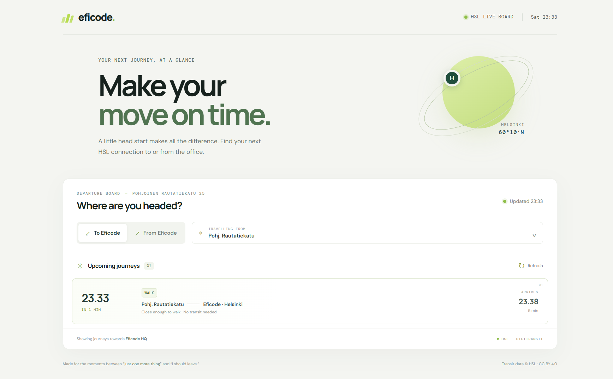

# Assignment: Timetables

Eficode headquarters is located at [Pohjoinen Rautatiekatu 25](https://www.google.com/maps/place/Pohjoinen+Rautatiekatu+25,+00100+Helsinki). Even while it is close to various public transportation options, people might still be easily late from work. And what's worst, our people might forget to leave early as they are working on something challenging or enjoying our rooftop sauna.

Your task is to help Eficodeans leave at the right time so that they would not miss any important, or why not less important, commitments.

## The task

Your task is to create an info screen, which displays the public transportation timetables between a location or a stop of your selection and Eficode headquarters. You can either display the schedules for the location someone would travel to the Eficode headquarters from, or then schedules from Eficode to the location of your selection.

### Mandatory

* Use the Helsinki Regional Transport (HSL) [open data interface](https://www.hsl.fi/en/opendata).
* Use [graphql](https://graphql.org/) as the query language.
* Publish your solution as a user interface in cloud of your selection so that it is accessible through a browser.
* Use [docker](https://docs.docker.com/) for packaging your application, even if you published it in some other way.

### Optional

* Write the solution using [React](https://reactjs.org/).
* Use a UI framework (e.g. [uikit](https://getuikit.com/)) and make the display pretty.
* Add user interface (e.g. [Robot Framework](https://robotframework.org/)) and/or unit testing (e.g. [Jest](https://jestjs.io/)).
* Add [eslint](http://eslint.org/).
* Add any funtionalities that do not disrupt the usability, but feel important to you.

## Returning your solution

* Publish the application into a cloud of your selection.
* Create a personal repository in [github](https://github.com) where you push your solution into.
* Send us the urls where to find the display and the code.

## Implementation

The app uses a React + TypeScript browser UI and a small Node.js GraphQL server. The server queries the HSL region's Digitransit Journey Planner GraphQL API and keeps the subscription key out of browser code.

### Live application preview



Screenshot captured from the running application with live Digitransit journey data. The example shows a nearby stop with a short walking route to the office.

### Architecture and deployment flow

```mermaid
flowchart LR
	commuter[Commuter browser] -->|HTTPS| app[Azure Container App\nReact UI + Node GraphQL API]
	app -->|GraphQL query + subscription key| hsl[Digitransit HSL Routing API]
	app -->|health check| health[/health]

	subgraph delivery[GitHub Actions delivery]
		source[Push to main or master] --> ci[CI checks\ntests, types, build]
		ci --> image[Build Docker image]
		image --> registry[Azure Container Registry]
		ci --> terraform[Terraform apply]
		terraform -->|OIDC authentication| azure[Azure resource control plane]
		registry -->|commit-tagged image| app
	end

	tfstate[Azure Blob remote Terraform state] <-->|state read/write| terraform
	ghsecret[GitHub production secret\nDigitransit key] --> terraform
	terraform -->|Container App secret| app
```

The live request path is browser → Container App → Digitransit. On deployment, GitHub Actions tests the code, builds and pushes a commit-tagged image, and Terraform configures the Azure resources. The Terraform state backend must be protected because it stores the configured Container App secret.

### User flow


This flow describes how a commuter selects an HSL stop, chooses a direction, and views refreshed journey results.

### Prerequisites

- Node.js 22 or newer
- A Digitransit API subscription key. Register through the [Digitransit API portal](https://portal-api.digitransit.fi/); production API requests require a key.

### Run locally

1. In this directory, copy `.env.example` to `.env` and set `DIGITRANSIT_SUBSCRIPTION_KEY` to your key. Do not commit `.env`.
2. Install dependencies with `npm install`.
3. Start the frontend and API server together with `npm run dev`.
4. Open the Vite URL printed in the terminal (normally `http://localhost:5173`).

The API server listens on port 4000 by default. The frontend proxies `/graphql` and `/health` to it. Journey results refresh every minute; use the refresh control to request them sooner.

### Build and run with Docker

Build the container image with `docker build -t eficode-timetables .`, then run it with `docker run --rm -p 4000:4000 --env-file .env eficode-timetables`. Open `http://localhost:4000`. The container's `/health` endpoint returns a small JSON health response.

For cloud hosting, publish this image to a container registry and configure `DIGITRANSIT_SUBSCRIPTION_KEY` as a server-side secret in the host's environment settings. Set the service to listen on port 4000 (or provide the port through `PORT`). Verify `/health` and the public HTTPS UI after deployment. No cloud deployment has been performed from this repository yet; it requires a cloud account and registry access.

### Checks

- `npm test` runs journey normalization tests.
- `npm run typecheck` checks the frontend and backend TypeScript.
- `npm run build` creates the production frontend and server output.

Transit data is provided by HSL/Digitransit and is used under the applicable [HSL open-data terms](https://www.hsl.fi/en/opendata).

## Azure deployment: Terraform + GitHub Actions

The repository includes Terraform for Azure Container Apps and GitHub Actions CI. Pushes to `main` or `master` run tests, type-checking, production build, and Terraform validation, and build/publish a commit-tagged container image to GHCR. The Azure deploy workflow is manual-only and requires GitHub OIDC backed by an authorized Entra service principal; it is not automatically run on push. For a first deployment without that identity, use the signed-in Azure CLI account as described below. The Container App is publicly reachable over HTTPS on port 4000, keeps one minimum replica for responsive availability and telemetry, and receives the Digitransit key as an Azure Container Apps secret. Terraform uses the existing resource group; it does not create or delete the resource group itself.

### What Terraform creates

- Log Analytics workspace and Container Apps environment in the existing resource group
- Public Container App with managed identity and HTTPS ingress
- Azure Monitor workbook, Container Apps HTTP diagnostics, and a threshold alert for repeated HTTP 5xx errors

### Observability

Terraform provisions an Azure Monitor Workbook named after the app with an Operations suffix in the existing resource group. It visualizes ingress request volume and p95 latency, recent HTTP errors, Digitransit dependency outcomes/latency, and Container Apps platform errors. It also enables Container Apps `HTTPLogs` in the existing Log Analytics workspace and creates an alert when five or more HTTP 5xx responses or Digitransit request failures occur within five minutes.

The Node server writes structured JSON events to stdout, which Container Apps forwards to its Log Analytics workspace. Events include request ID, operation, status, duration, and safe failure categories; request bodies, GraphQL query text, headers, and API keys are deliberately excluded. GraphQL resolver failures are logged because GraphQL can return application errors with HTTP 200. To receive email for the alert, set the optional GitHub production Environment variable `AZURE_ALERT_EMAIL`; if omitted, Azure records the alert but sends no notification.

Find the workbook in **Azure portal → Monitor → Workbooks** or on the Log Analytics workspace. Terraform outputs also include the workspace and workbook resource IDs. Log ingestion, retention, scheduled-query alerts, and notification delivery may incur Azure charges; review usage after enabling them. Ingress logs can contain request metadata, so keep access restricted and avoid putting sensitive values in request URLs.

Terraform is in `infra/terraform/`; workflows are in `.github/workflows/`. Your provided group is `RG_MohammedIbrahim` in `swedencentral`; verify the name/location and that it belongs to the active subscription before using it:

```powershell
az account show --query "{subscription:name,id:id,tenant:tenantId}" --output table
az group show --name RG_MohammedIbrahim --query "{name:name,location:location,id:id}" --output table
```

The app resources are configured to deploy into that group and region. The signed-in identity needs sufficient rights to create those resources and role assignments. The local deployment path uses the signed-in user for ACR image-push permission; GitHub deployment uses a service principal instead.

### Manual deployment using your Azure CLI login

This route does not require a new service principal. It uses your signed-in Azure identity to provision the app from the public GitHub Container Registry image. The current account must have resource creation permissions in `RG_MohammedIbrahim`. It does not need to create registry role assignments.

Before running it, ensure the Digitransit key pasted into chat has been rotated and the replacement is in your local ignored `.env`. Never display or commit that value. The Terraform state is stored in a private Azure Blob container because it includes the app secret. A one-time state storage account/container was created in the existing group; confirm its name with the deployment operator rather than create a local Terraform state.

```powershell
az login
az account set --subscription SUBSCRIPTIONID
$rg = "RG_MohammedIbrahim"
$stateStorage = "hslstatecc1d8394"
$userObjectId = az ad signed-in-user show --query id --output tsv

terraform -chdir=infra/terraform init -reconfigure `
	-backend-config="resource_group_name=$rg" `
	-backend-config="storage_account_name=$stateStorage" `
	-backend-config="container_name=tfstate" `
	-backend-config="key=timetables.tfstate" `
	-backend-config="use_azuread_auth=true" `
	-backend-config="use_cli=true"

$env:TF_VAR_resource_group_name = $rg
$env:TF_VAR_location = "swedencentral"
$env:TF_VAR_app_name = "hsl-commute-board-ibrahimm12"
$env:TF_VAR_acr_name = "eficodetimetablechange"
$env:TF_VAR_container_image = "ghcr.io/ibrahimm12/helsinki-hsl-commute-board:latest"
$env:TF_VAR_digitransit_subscription_key = ((Get-Content .env | Where-Object { $_ -match '^DIGITRANSIT_SUBSCRIPTION_KEY=' } | Select-Object -First 1) -split '=', 2)[1].Trim().Trim('"').Trim("'")

# Apply creates the app, Log Analytics, HTTP diagnostics, workbook, and alert.
terraform -chdir=infra/terraform apply -auto-approve
terraform -chdir=infra/terraform output -raw app_url
```

Keep the Terraform state storage account and blob container; do not use a local state file or delete these backend resources. The API key is passed through the process environment, not written into a tracked tfvars file. After deployment, open the printed HTTPS URL and the Operations workbook in Azure Monitor. Azure may charge for provisioned resources and Log Analytics ingestion.

### One-time Azure/GitHub setup

1. **Rotate the Digitransit key that was pasted into the conversation.** Create a replacement in the Digitransit portal. Never commit it or paste it in an issue/chat.
2. **Create an Azure app registration and service principal** for GitHub Actions. Add a federated credential in Microsoft Entra ID with:
	- Issuer: `https://token.actions.githubusercontent.com`
	- Subject: `repo:OWNER/REPOSITORY:environment:production` (replace with the actual GitHub owner and repository)
	- Audience: `api://AzureADTokenExchange`
3. **For GitHub OIDC deployment, grant the service principal permissions**:
	- `Contributor` on the existing `RG_MohammedIbrahim` resource group. The workflow creates Container Apps and Log Analytics resources there. It uses the public GHCR image and creates no Azure role assignments.
	- `Storage Blob Data Contributor` on the Terraform state storage account/container.
	- Prefer narrower scopes where your organization's Azure policy permits them. Role assignment permissions are required because Terraform assigns registry push/pull roles.
4. **For GitHub OIDC deployment, create a Terraform state storage account/blob container** accessible to both the service principal and authorized maintainers. The manual deployment above bootstraps its remote state storage account in the existing application resource group; never store Terraform state locally or publish it as a workflow artifact.

	```powershell
	$stateRg = "rg-timetables-tfstate"
	$stateStorage = "timetablestfstate12345"
	az group create --name $stateRg --location swedencentral
	az storage account create --name $stateStorage --resource-group $stateRg --location swedencentral --sku Standard_LRS --min-tls-version TLS1_2 --allow-blob-public-access false
	az storage container create --name tfstate --account-name $stateStorage --auth-mode login
	az storage account blob-service-properties update --account-name $stateStorage --enable-versioning true --enable-delete-retention true --delete-retention-days 30
	```

	The state is remote because Terraform state contains the Digitransit secret value. Do not switch this project to a local state file or publish/download state as a workflow artifact. Restrict state storage access and retain blob versioning for recovery.
5. **Create a GitHub Environment named `production`** (Repository → Settings → Environments). Restrict allowed deployment branches to your protected `main`/`master` branch and, if appropriate, require a reviewer before production deployments. Add these environment variables:

	| Variable | Value |
	| --- | --- |
	| `AZURE_CLIENT_ID` | Application (client) ID of the Entra app registration |
	| `AZURE_TENANT_ID` | Entra tenant ID |
	| `AZURE_SUBSCRIPTION_ID` | Azure subscription ID |
	| `AZURE_RESOURCE_GROUP` | Existing resource group, `RG_MohammedIbrahim` |
	| `AZURE_LOCATION` | Azure region, e.g. `swedencentral` |
	| `AZURE_APP_NAME` | `hsl-commute-board-ibrahimm12` or another unique valid app name |
	| `TF_STATE_RESOURCE_GROUP` | Not needed; the deploy workflow uses `AZURE_RESOURCE_GROUP` for the state resource group |
	| `TF_STATE_STORAGE_ACCOUNT` | Globally unique storage account name created above |
	| `TF_STATE_CONTAINER` | State container name, e.g. `tfstate` |
	| `AZURE_ALERT_EMAIL` | Optional: email to notify when the HTTP 5xx alert fires |

	Add this **environment secret**:

	| Secret | Value |
	| --- | --- |
	| `DIGITRANSIT_SUBSCRIPTION_KEY` | The rotated key subscribed to **Routing v2 HSL GTFS** |

6. Set the GHCR package visibility to **Public** (the Container App pulls the image without a registry credential), then push the project to `main` or `master`. Wait for **Publish container image** to finish successfully. For GitHub OIDC deployment, set the `container_image` Terraform variable to the commit-tagged GHCR image; run **Deploy to Azure Container Apps** manually under Actions. This workflow is manual-only so a push does not fail before OIDC is configured. For the initial local Azure CLI deployment, first confirm the `latest` GHCR image exists and is public. If Terraform/provider configuration changes after initialization, review and commit the updated `infra/terraform/.terraform.lock.hcl`.
7. After a successful run, the Actions log prints the HTTPS URL. The same URL is available from the `app_url` Terraform output.

**State/secret note:** the Terraform variable is marked sensitive, but Terraform necessarily stores the Container Apps secret value in its state. Protect the remote state account with least-privilege RBAC, private access/network restrictions where available, and blob versioning. For a stricter production setup, replace the state-stored secret with an Azure Key Vault reference before deployment.

The workflow uses GitHub OIDC (no long-lived Azure client secret). Azure subscription, GitHub repository/environment, and a valid Digitransit subscription key are required; these are intentionally not embedded in the repository.
