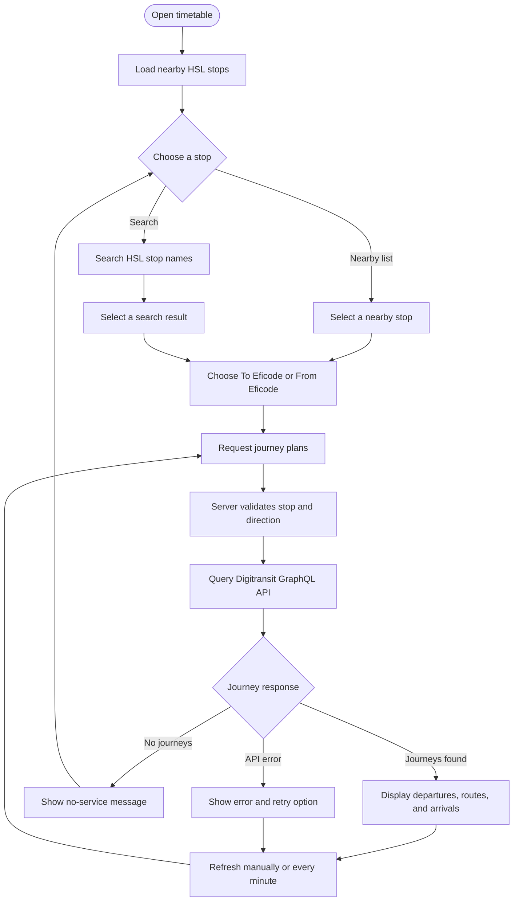

# Assignment: Timetables

Eficode headquarters is located at [Pohjoinen Rautatiekatu 25](https://www.google.com/maps/place/Pohjoinen+Rautatiekatu+25,+00100+Helsinki). Even while it is close to various public transportation options, people might still be easily late from work. And what's worst, our people might forget to leave early as they are working on something challenging or enjoying our rooftop sauna.

Your task is to help Eficodeans leave at the right time so that they would not miss any important, or why not less important, commitments.

## The task

Your task is to create an info screen, which displays the public transportation timetables between a location or a stop of your selection and Eficode headquarters. You can either display the schedules for the location someone would travel to the Eficode headquarters from, or then schedules from Eficode to the location of your selection.

### Mandatory

* Use the Helsinki Regional Transport (HSL) [open data interface](https://www.hsl.fi/en/opendata).
* Use [graphql](https://graphql.org/) as the query language.
* Publish your solution as a user interface in cloud of your selection so that it is accessible through a browser.
* Use [docker](https://docs.docker.com/) for packaging your application, even if you published it in some other way.

### Optional

* Write the solution using [React](https://reactjs.org/).
* Use a UI framework (e.g. [uikit](https://getuikit.com/)) and make the display pretty.
* Add user interface (e.g. [Robot Framework](https://robotframework.org/)) and/or unit testing (e.g. [Jest](https://jestjs.io/)).
* Add [eslint](http://eslint.org/).
* Add any funtionalities that do not disrupt the usability, but feel important to you.

## Returning your solution

* Publish the application into a cloud of your selection.
* Create a personal repository in [github](https://github.com) where you push your solution into.
* Send us the urls where to find the display and the code.

## Implementation

The app uses a React + TypeScript browser UI and a small Node.js GraphQL server. The server queries the HSL region's Digitransit Journey Planner GraphQL API and keeps the subscription key out of browser code.

### Live application preview


Screenshot captured from the running application with live Digitransit journey data. The example shows a nearby stop with a short walking route to the office.

### Architecture and deployment flow

```mermaid
flowchart LR
	commuter[Commuter browser] -->|HTTPS| app[Azure Container App\nReact UI + Node GraphQL API]
	app -->|GraphQL query + subscription key| hsl[Digitransit HSL Routing API]
	app -->|health check| health[/health]

	subgraph delivery[GitHub Actions delivery]
		source[Push to main or master] --> ci[CI checks\ntests, types, build]
		ci --> image[Build Docker image]
		image --> registry[Azure Container Registry]
		ci --> terraform[Terraform apply]
		terraform -->|OIDC authentication| azure[Azure resource control plane]
		registry -->|commit-tagged image| app
	end

	tfstate[Azure Blob remote Terraform state] <-->|state read/write| terraform
	ghsecret[GitHub production secret\nDigitransit key] --> terraform
	terraform -->|Container App secret| app
```

The live request path is browser → Container App → Digitransit. On deployment, GitHub Actions tests the code, builds and pushes a commit-tagged image, and Terraform configures the Azure resources. The Terraform state backend must be protected because it stores the configured Container App secret.

### User flow



This flow describes how a commuter selects an HSL stop, chooses a direction, and views refreshed journey results.

### Prerequisites

- Node.js 22 or newer
- A Digitransit API subscription key. Register through the [Digitransit API portal](https://portal-api.digitransit.fi/); production API requests require a key.

### Run locally

1. In this directory, copy `.env.example` to `.env` and set `DIGITRANSIT_SUBSCRIPTION_KEY` to your key. Do not commit `.env`.
2. Install dependencies with `npm install`.
3. Start the frontend and API server together with `npm run dev`.
4. Open the Vite URL printed in the terminal (normally `http://localhost:5173`).

The API server listens on port 4000 by default. The frontend proxies `/graphql` and `/health` to it. Journey results refresh every minute; use the refresh control to request them sooner.

### Build and run with Docker

Build the container image with `docker build -t eficode-timetables .`, then run it with `docker run --rm -p 4000:4000 --env-file .env eficode-timetables`. Open `http://localhost:4000`. The container's `/health` endpoint returns a small JSON health response.

For cloud hosting, publish this image to a container registry and configure `DIGITRANSIT_SUBSCRIPTION_KEY` as a server-side secret in the host's environment settings. Set the service to listen on port 4000 (or provide the port through `PORT`). Verify `/health` and the public HTTPS UI after deployment. No cloud deployment has been performed from this repository yet; it requires a cloud account and registry access.

### Checks

- `npm test` runs journey normalization tests.
- `npm run typecheck` checks the frontend and backend TypeScript.
- `npm run build` creates the production frontend and server output.

Transit data is provided by HSL/Digitransit and is used under the applicable [HSL open-data terms](https://www.hsl.fi/en/opendata).

## Azure deployment: Terraform + GitHub Actions

The repository includes Terraform for Azure Container Apps and an automated GitHub Actions deployment. A merge/push to `main` or `master` runs CI (tests, type-check, production build, and Terraform validation), then the deployment workflow builds the Docker image, pushes an immutable commit-tagged image to Azure Container Registry, and applies the Terraform configuration. The Container App is publicly reachable over HTTPS on port 4000. It scales to zero when idle and receives the Digitransit key as an Azure Container Apps secret. Terraform uses an existing resource group; it does not create or delete the resource group itself.

### What Terraform creates

- Log Analytics workspace and Container Apps environment in the existing resource group
- Azure Container Registry (Basic, admin account disabled)
- Public Container App with managed identity and HTTPS ingress
- Scoped `AcrPush` access for the GitHub deployment identity and `AcrPull` access for the app identity

Terraform is in `infra/terraform/`; workflows are in `.github/workflows/`. No Azure resources are created until you configure the prerequisites and run the workflow. Your provided group is `RG_MohammedIbrahim` in `swedencentral`; verify the name/location and that it belongs to the active subscription before using it:

```powershell
az account show --query "{subscription:name,id:id,tenant:tenantId}" --output table
az group show --name RG_MohammedIbrahim --query "{name:name,location:location,id:id}" --output table
```

The app resources are configured to deploy into that group and region. The signed-in identity still needs sufficient rights to create those resources. Terraform also creates ACR role assignments, which require role-assignment permissions.

### One-time Azure/GitHub setup

1. **Rotate the Digitransit key that was pasted into the conversation.** Create a replacement in the Digitransit portal. Never commit it or paste it in an issue/chat.
2. **Create an Azure app registration and service principal** for GitHub Actions. Add a federated credential in Microsoft Entra ID with:
	- Issuer: `https://token.actions.githubusercontent.com`
	- Subject: `repo:OWNER/REPOSITORY:environment:production` (replace with the actual GitHub owner and repository)
	- Audience: `api://AzureADTokenExchange`
3. **Grant the service principal permissions**:
	- `Contributor` and `Role Based Access Control Administrator` on the existing `RG_MohammedIbrahim` resource group. The workflow creates the Container Apps, Log Analytics, and registry resources inside it and assigns registry push/pull roles. If the organization does not permit these roles, Terraform will fail; do not attempt to bypass tenant policy.
	- `Storage Blob Data Contributor` on the Terraform state storage account/container.
	- Prefer narrower scopes where your organization's Azure policy permits them. Role assignment permissions are required because Terraform assigns registry push/pull roles.
4. **Create the Terraform state storage account and blob container once**, in a separate state resource group, before running the workflow. For example, after `az login`, choose globally unique lowercase values for `$stateStorage` and your resource-group names and run these commands in PowerShell:

	```powershell
	$stateRg = "rg-timetables-tfstate"
	$stateStorage = "timetablestfstate12345"
	az group create --name $stateRg --location swedencentral
	az storage account create --name $stateStorage --resource-group $stateRg --location swedencentral --sku Standard_LRS --min-tls-version TLS1_2 --allow-blob-public-access false
	az storage container create --name tfstate --account-name $stateStorage --auth-mode login
	az storage account blob-service-properties update --account-name $stateStorage --enable-versioning true --enable-delete-retention true --delete-retention-days 30
	```

	The state is remote because Terraform state contains the Digitransit secret value. Do not switch this project to a local state file or publish/download state as a workflow artifact. Restrict state storage access and retain blob versioning for recovery.
5. **Create a GitHub Environment named `production`** (Repository → Settings → Environments). Restrict allowed deployment branches to your protected `main`/`master` branch and, if appropriate, require a reviewer before production deployments. Add these environment variables:

	| Variable | Value |
	| --- | --- |
	| `AZURE_CLIENT_ID` | Application (client) ID of the Entra app registration |
	| `AZURE_PRINCIPAL_OBJECT_ID` | Object ID of its enterprise application/service principal (not the client ID) |
	| `AZURE_TENANT_ID` | Entra tenant ID |
	| `AZURE_SUBSCRIPTION_ID` | Azure subscription ID |
	| `AZURE_RESOURCE_GROUP` | Existing resource group, `RG_MohammedIbrahim` |
	| `AZURE_LOCATION` | Azure region, e.g. `swedencentral` |
	| `AZURE_APP_NAME` | Unique Container App name, e.g. `eficode-timetables-yourname` |
	| `AZURE_ACR_NAME` | Globally unique 5–50 character lowercase-alphanumeric registry name |
	| `TF_STATE_RESOURCE_GROUP` | Resource group containing the remote-state storage account |
	| `TF_STATE_STORAGE_ACCOUNT` | Globally unique storage account name created above |
	| `TF_STATE_CONTAINER` | State container name, e.g. `tfstate` |

	Add this **environment secret**:

	| Secret | Value |
	| --- | --- |
	| `DIGITRANSIT_SUBSCRIPTION_KEY` | The rotated key subscribed to **Routing v2 HSL GTFS** |

6. Push to `main` or `master` (or run **Deploy to Azure Container Apps** manually under Actions). The first run provisions the Azure resources with a temporary public bootstrap image, then builds/pushes the real image and applies Terraform again. Later runs update the app to the new commit image. If Terraform/provider configuration changes after initialization, review and commit the updated `infra/terraform/.terraform.lock.hcl`.
7. After a successful run, the Actions log prints the HTTPS URL. The same URL is available from the `app_url` Terraform output.

**State/secret note:** the Terraform variable is marked sensitive, but Terraform necessarily stores the Container Apps secret value in its state. Protect the remote state account with least-privilege RBAC, private access/network restrictions where available, and blob versioning. For a stricter production setup, replace the state-stored secret with an Azure Key Vault reference before deployment.

The workflow uses GitHub OIDC (no long-lived Azure client secret). Azure subscription, GitHub repository/environment, and a valid Digitransit subscription key are required; these are intentionally not embedded in the repository.
