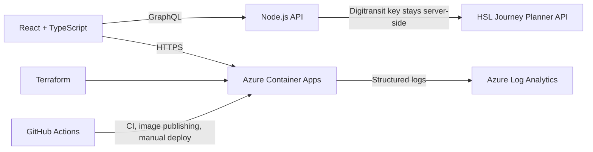

# Helsinki HSL Timetables

**Know when to leave.** A commuter information screen for journeys between Helsinki-region HSL stops and Eficode's Helsinki office. Choose a nearby or searched stop, select a direction, and see upcoming routes and departures.


The screenshot shows the product UI with example journey data. HSL journey data is fetched live when the application is running and configured with a valid Digitransit key.

## Website Walkthrough

[Watch the 95-second explained website demo (WebM)](docs/videos/assignment-timetables-demo.webm)

The walkthrough starts on the fully loaded website and uses chapter captions and British English synthetic narration (Microsoft Hazel) to explain stop selection, departure countdowns, routes and transfers, arrival times, direction switching, search, saved preferences, and refresh. Closing chapters explain the React/GraphQL architecture and the repository's Docker, CI, Terraform, and observability configuration. It uses simulated journey responses, labelled throughout as sample data, and does not demonstrate a live HSL connection or Azure deployment. The timed narration transcript is available in [narration.json](docs/videos/narration.json).

## Product

- Find nearby HSL stops or search by stop name.
- Choose journeys to or from the office.
- Compare upcoming departures, walking segments, and arrivals.
- Refresh results manually or automatically.
- Keep the Digitransit subscription key on the server, outside browser code.

## Architecture



## Cloud and DevOps

| Area | Implementation |
| --- | --- |
| Application | React + TypeScript UI with a Node.js GraphQL API |
| Data source | HSL/Digitransit Journey Planner open-data API |
| Container | Docker image published to GitHub Container Registry (GHCR) |
| Infrastructure | Terraform for Azure Container Apps and Log Analytics |
| Delivery | GitHub Actions CI, image publishing, and manually triggered Azure deployment |
| Observability | Health endpoint, structured server logs, Azure Monitor workbook, and HTTP 5xx alert |
| Identity | GitHub OIDC for Azure deployment; no long-lived Azure client secret in the workflow |

CI runs tests, TypeScript checks, the production build, and Terraform validation on pull requests and pushes to `main` or `master`. A separate workflow publishes a commit-tagged container image to GHCR. Azure deployment is manual and requires the repository's `production` GitHub Environment to be configured with Azure OIDC settings and the Digitransit key.

The Terraform setup is **cloud-ready, not automatically provisioned by a push**. No live Azure deployment is claimed by this repository. Provisioning requires your own Azure subscription, permissions, remote Terraform state, and GitHub Environment configuration.

Terraform also configures Container Apps diagnostics, an Azure Monitor workbook for ingress and dependency health, and an alert for repeated HTTP 5xx or Digitransit failures. Review Azure Monitor and Log Analytics costs before deployment. Protect the remote Terraform state because it contains the configured Container App secret.

## Run Locally

Requirements: Node.js 22 or newer and a Digitransit subscription key. Register through the [Digitransit API portal](https://portal-api.digitransit.fi/).

1. Copy `.env.example` to `.env` and set `DIGITRANSIT_SUBSCRIPTION_KEY`. Never commit `.env` or paste the key into issues or chat.
2. Install dependencies and start the UI and GraphQL API:

```sh
npm ci
npm run dev
```

3. Open the Vite URL printed in the terminal, normally `http://localhost:5173`.

The API listens on port `4000` by default. The frontend proxies `/graphql` and `/health` to it. Journey results refresh every minute; use the refresh control to request them sooner.

## Build and Verify

```sh
npm test
npm run typecheck
npm run build
docker build -t hsl-commute-board .
```

Run the container with the key supplied through the environment:

```sh
docker run --rm -p 4000:4000 --env-file .env hsl-commute-board
```

Then open `http://localhost:4000`. The `/health` endpoint returns the service health response.

## Azure Deployment

The Azure workflow is manual-only (`workflow_dispatch`). Configure a GitHub Environment named `production`, enable GitHub OIDC in Microsoft Entra ID, and provide the values referenced by `.github/workflows/deploy-azure.yml`: Azure client, tenant, and subscription IDs; resource group, region, app name; remote Terraform state storage account/container; and the `DIGITRANSIT_SUBSCRIPTION_KEY` environment secret. Use your own Azure resource names and keep them in GitHub Environment configuration, not in tracked files.

Review `terraform plan`, required Azure permissions, and estimated costs before applying infrastructure. Terraform is in [`infra/terraform`](infra/terraform/).

## Data and License

The application source code is licensed under the MIT License; see [LICENSE](LICENSE). Transit data is provided by HSL/Digitransit and remains subject to the applicable [HSL open-data terms](https://www.hsl.fi/en/opendata), which are separate from the code license. Check those terms before redistribution or production use.

<details>
<summary>Original assignment brief</summary>

Build a browser-accessible public-transit timetable display for journeys between an HSL stop and Eficode's Helsinki headquarters. The assignment requires the HSL open-data interface, GraphQL, cloud publication, and Docker packaging. This repository implements those requirements with an additional React UI, tests, CI, Terraform, and observability configuration.

</details>
